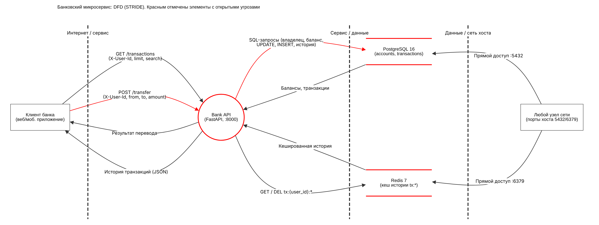

# Модуль B «Защита ИТ-инфраструктуры»: моделирование угроз и управление уязвимостями банковского микросервиса

**Объект:** микросервис перевода средств между счетами и просмотра истории транзакций (`microservice/`): Backend API на FastAPI (HTTP/REST), PostgreSQL 16, Redis 7, запуск через docker-compose.

| Файл | Что внутри |
|---|---|
| [`threat-model/threat-model-report.pdf`](threat-model/threat-model-report.pdf) | Отчёт OWASP Threat Dragon v2.6.2 (PDF): DFD, угрозы по элементам, контрмеры |
| [`threat-model/bank-threat-model.json`](threat-model/bank-threat-model.json) | Модель для импорта в OWASP Threat Dragon |
| [`threat-model/dfd.png`](threat-model/dfd.png) | DFD-диаграмма |
| [`sast/semgrep_results.json`](sast/semgrep_results.json) | **Итог SAST:** результаты Semgrep + 2 находки IDOR, добавленные вручную, + триаж |
| [`sast/semgrep_raw.json`](sast/semgrep_raw.json) | «Сырой» вывод Semgrep без правок |
| [`sast/custom-rules.yml`](sast/custom-rules.yml) | 30 кастомных правил Semgrep |
| [`sast/run_semgrep.sh`](sast/run_semgrep.sh) | Команда запуска сканирования |
| [`sca/pip-audit.json`](sca/pip-audit.json) | SCA: уязвимые зависимости (pip-audit) |
| [`poc/test_poc.py`](poc/test_poc.py) | Проверка на запущенном сервисе: IDOR, SQLi, race condition |
| [`poc/verify_logic.py`](poc/verify_logic.py) | Проверка на запущенном сервисе: deadlock, перевод самому себе, кеш, ошибки 500, перебор счетов |
| [`poc/verify_resilience.py`](poc/verify_resilience.py) | Проверка: сбой Redis после коммита, Redis как точка отказа, исчерпание пула БД, утечка через transaction_id |
| [`poc/verify_replicas_init.py`](poc/verify_replicas_init.py) | Проверка: гонка init_db при старте нескольких реплик |

---

## 1. Модель угроз

### 1.1 Data Flow Diagram (DFD)

**Элементы:**

| Элемент | Тип DFD | Описание |
|---|---|---|
| Клиент банка | Внешняя сущность | Веб- или мобильное приложение. Передаёт свой ID в заголовке `X-User-Id` |
| Bank API (FastAPI, :8000) | Процесс | `POST /transfer`, `GET /transactions` |
| PostgreSQL 16 | Хранилище | Таблицы `accounts` (владелец, баланс) и `transactions` |
| Redis 7 | Хранилище | Кеш истории транзакций, ключи `tx:<user_id>:<limit>:<search>` |
| Любой узел сети | Внешняя сущность | Показывает реальную поверхность атаки: в `docker-compose.yml` порты 5432 и 6379 опубликованы на хосте |

**Потоки данных:**

| № | Откуда → куда | Данные | Протокол / защита |
|---|---|---|---|
| 1 | Клиент → API | `POST /transfer`: X-User-Id, from_account_id, to_account_id, amount_cents | HTTP, без TLS, без аутентификации |
| 2 | API → Клиент | transaction_id или ошибка | HTTP |
| 3 | Клиент → API | `GET /transactions`: X-User-Id, limit, search | HTTP |
| 4 | API → Клиент | История транзакций (JSON) | HTTP |
| 5 | API → PostgreSQL | Проверка владельца, SELECT/UPDATE баланса, INSERT транзакции, SELECT истории | asyncpg, без TLS, superuser postgres |
| 6 | PostgreSQL → API | Балансы, транзакции | — |
| 7 | API → Redis | GET кеша истории, DEL `tx:<user_id>` после перевода | redis:// без пароля и TLS |
| 8 | Redis → API | Кешированная история | — |
| 9, 10 | Узел сети → PostgreSQL / Redis | Прямое подключение к :5432 / :6379 в обход API | Порты опубликованы |

**Границы доверия:** «Интернет / сервис» (между клиентом и API), «Сервис / данные» (внутренняя Docker-сеть), «Данные / сеть хоста» (нарушена публикацией портов).

### 1.2 Три наиболее критичные угрозы

Угрозы искали по STRIDE для каждого элемента DFD; всего в модели 31 угрозы (полный список ниже и в PDF). Три главные выбраны по совокупности трёх факторов: импакт, поверхность атаки и влияние на бизнес-процессы банка. Две из трёх подтверждены запуском сервиса (PostgreSQL 16, скрипт `poc/test_poc.py`).

#### ТОП-1. Подмена личности через `X-User-Id` → IDOR/BOLA (STRIDE: Spoofing) — Critical, CVSS 9.1

- **Суть.** «Кто ты» сервис узнаёт из заголовка `X-User-Id` (`app/security.py`), который клиент подставляет сам. Проверки владения в коде есть: `_must_own_account` для `/transfer` и фильтр `owner_user_id` для `/transactions`. Но сравнивают они объект с подделываемым значением. ID пользователей и счетов — последовательные (`BIGSERIAL`), так что перебор тривиален.
- **Подтверждено:** перевод со счёта 1 с `X-User-Id: 2` → **403**; тот же запрос с `X-User-Id: 1` → **200**, деньги списаны. `GET /transactions` с `X-User-Id: 1` отдаёт чужую историю.
- **Импакт:** кража средств с любого счёта и утечка истории операций всех клиентов (C:H, I:H).
- **Поверхность атаки:** публичный API, оба эндпоинта. Не нужны ни учётная запись, ни специальные знания, хватит curl.
- **Бизнес:** прямые финансовые потери и компенсации, нарушение банковской тайны (ст. 26 ФЗ «О банках и банковской деятельности») и 152-ФЗ, санкции регулятора, репутационный ущерб.

| Контрмера | Тип | Уровень | Какую угрозу снижает |
|---|---|---|---|
| Аутентификация по подписанному токену (OAuth2/OIDC, JWT с проверкой подписи, `iss`, `aud`, `exp`); `user_id` берётся только из claim `sub` | Техническая | Код | Устраняет подмену личности — корень IDOR |
| Единый слой объектной авторизации (deny-by-default) для каждого обращения к счёту/истории + unit-тесты «пользователь A → объект B» | Техническая | Код | BOLA при ошибке в отдельном эндпоинте |
| API Gateway + IdP перед сервисом: аутентификация на периметре, удаление входящих `X-User-Id`, mTLS gateway↔сервис | Архитектурная | Инфраструктура | Обход аутентификации прямым запросом к сервису |
| Непредсказуемые идентификаторы счетов (UUID) | Архитектурная | Код / БД | Перебор объектов (дополнительный барьер, авторизацию не заменяет) |
| Обязательные негативные тесты авторизации в CI, DAST-проверка BOLA перед релизом, security code review изменений auth-слоя | Процессная | Процесс | Повторное появление IDOR при доработках |

#### ТОП-2. Гонка при переводе (TOCTOU) → двойное списание (STRIDE: Tampering) — Critical, CVSS 7.1 (8.2 в связке с ТОП-1)

- **Суть.** В `crud.transfer` баланс читается обычным `SELECT` без блокировки строки, проверка `bal < amount` выполняется в приложении, а списание — отдельным `UPDATE`. При уровне изоляции READ COMMITTED параллельные запросы одновременно проходят проверку.
- **Подтверждено:** 10 параллельных переводов всего баланса счёта (251 000) → **5 успешных**, итоговый баланс **−1 004 000**. На другом счёте появились деньги, которых не было.
- **Импакт:** нарушение целостности балансов: создание денег «из воздуха» и вывод средств сверх остатка.
- **Поверхность атаки:** любой клиент со своим счётом (а с учётом ТОП-1 — вообще любой). Достаточно отправить N запросов параллельно.
- **Бизнес:** прямые потери, расхождение с бухгалтерским учётом и отчётностью, остановка сервиса переводов на время расследования. Severity повышена до Critical из-за прямого денежного ущерба.

| Контрмера | Тип | Уровень | Какую угрозу снижает |
|---|---|---|---|
| Атомарное списание: `UPDATE accounts SET balance_cents = balance_cents - $1 WHERE id = $2 AND balance_cents >= $1 RETURNING …` либо `SELECT … FOR UPDATE` с блокировкой счетов в порядке id | Техническая | Код / БД | Убирает окно TOCTOU |
| Ограничение `CHECK (balance_cents >= 0)` в таблице `accounts` | Техническая | БД | Последняя линия защиты: отрицательный баланс невозможен |
| Ключ идемпотентности (`Idempotency-Key`) для `POST /transfer` | Техническая | Код | Повторы и дубли запросов |
| Учёт по модели ledger (проводки debit/credit) + ежедневная автоматическая сверка | Архитектурная | Архитектура данных | Незамеченное расхождение балансов |
| Конкурентные тесты денежных операций в CI, лимиты операций и антифрод-мониторинг серий переводов | Процессная | Процесс | Регрессия и массовая эксплуатация |

#### ТОП-3. PostgreSQL (и Redis) опубликованы наружу с паролем по умолчанию (STRIDE: Elevation of privilege) — Critical, CVSS 9.8

- **Суть.** В `docker-compose.yml` порты `5432:5432` и `6379:6379` опубликованы на всех интерфейсах хоста. БД работает под суперпользователем `postgres` с паролем `postgres`, записанным открытым текстом в репозитории. Redis без пароля. Соединения без TLS.
- **Импакт:** полный контроль над данными в обход API: чтение всех счетов, изменение балансов, удаление данных. Суперпользователь PostgreSQL может выполнять команды ОС (`COPY … PROGRAM`), то есть компрометация распространяется на хост (C:H, I:H, A:H).
- **Поверхность атаки:** любой узел с сетевым доступом к хосту. Пароль из словаря по умолчанию и к тому же лежит в Git.
- **Бизнес:** утечка банковской тайны всех клиентов, фальсификация балансов, остановка сервиса. Инцидент подлежит уведомлению регулятора.

| Контрмера | Тип | Уровень | Какую угрозу снижает |
|---|---|---|---|
| Не публиковать 5432/6379: БД и Redis только во внутренней сети, доступ только от API (Docker internal network, NetworkPolicy, security groups) | Архитектурная | Инфраструктура | Убирает поверхность атаки |
| Отдельная учётная запись приложения с минимальными правами (без superuser); пароли из менеджера секретов (Vault, Docker/K8s secrets) с ротацией; ACL-пароль и отключение опасных команд в Redis | Техническая | Инфраструктура | Ущерб при утечке учётных данных |
| TLS для PostgreSQL (`sslmode=verify-full`) и Redis (`rediss://`); `pg_hba.conf`: scram-sha-256 и только адреса API | Техническая | Инфраструктура | Перехват и подбор учётных данных |
| Поиск секретов (gitleaks / Semgrep secrets) в pre-commit и CI, сканирование IaC (docker-compose, Helm), регулярный аудит открытых портов | Процессная | Процесс | Повторное попадание секретов и открытых портов в прод |

**Почему SQL Injection не вошла в ТОП-3.** В `crud.list_transactions` запрос собирается f-строкой — это опасный паттерн, и Semgrep его помечает. Но в строку попадают только номера плейсхолдеров (`$2`, `$3`), а значение `search` передаётся в asyncpg параметром. Payload'ы `' OR '1'='1` и `UNION SELECT` на запущенном сервисе вернули пустой результат: инъекция не эксплуатируется. Угроза оставлена в модели как латентная (Medium): при доработке значение легко подставить напрямую.

#### Остальные угрозы модели

| Угроза | STRIDE | Severity |
|---|---|---|
| Redis без пароля и TLS, порт опубликован: подмена кеша, FLUSHALL | Tampering | High |
| Передача данных клиента по HTTP без TLS | Information disclosure | High |
| Латентная SQL-инъекция (f-string построение запроса) | Tampering | Medium |
| Нет журнала аудита переводов | Repudiation | Medium |
| Нет rate limiting, тяжёлые `ILIKE '%…%'` | Denial of service | Medium |
| Трафик API ↔ PostgreSQL без шифрования | Information disclosure | Medium |
| Взаимоблокировка при встречных переводах (deadlock): подтверждено, 24 из 40 запросов → 500 | Denial of service | Medium |
| Сбой Redis после коммита: деньги списаны, клиент получает 500, повтор → двойное списание; подтверждено | Tampering | Medium |
| Redis — единая точка отказа истории: без Redis `GET /transactions` → 500; подтверждено | Denial of service | Medium |
| Исчерпание пула БД (5 соединений, без таймаутов): перевод 4 мс → 4,3 с при 10 поисках; подтверждено | Denial of service | Medium |
| Нет суточных лимитов и подтверждения крупных переводов (2FA): с ТОП-1 весь баланс выводится одним запросом | Tampering | Medium |
| Данные БД без шифрования на диске и без резервного копирования | Information disclosure | Medium |
| Скрытие истории клиента через запись в кеш Redis (при попадании в кеш возвращается `[]`): подтверждено | Tampering | Medium |
| Перевод самому себе (`from == to`) создаёт фиктивные транзакции: подтверждено | Tampering | Low |
| Нет проверки входных данных: `2^63` → 500, `X-User-Id: -5` и `" 1_0 "` принимаются; подтверждено | Denial of service | Low |
| Перебор существующих счетов через ответ «To account not found»: подтверждено | Information disclosure | Low |
| Уязвимые зависимости: starlette 0.38.6 (7 CVE), python-dotenv 1.0.1 (1 CVE) | Denial of service | Low |
| Нет FOREIGN KEY и индексов в схеме БД | Tampering | Low |
| Тестовые счета с деньгами создаются в продовом коде | Elevation of privilege | Low |
| DDL при старте: лишние права у приложения, гонка реплик задваивает счета; подтверждено | Elevation of privilege | Low |
| Последовательный `transaction_id` раскрывает объём операций банка; подтверждено | Information disclosure | Low |
| Контейнеры без лимитов ресурсов и healthcheck | Denial of service | Low |
| Контейнер API работает от root (пользователь не задан, Dockerfile отсутствует) | Elevation of privilege | Low |
| Ответы с историей без `Cache-Control: no-store`, HSTS и других заголовков; подтверждено | Information disclosure | Low |
| Зависимости без хешей и lock-файла (цепочка поставок) | Tampering | Low |
| Небезопасные значения по умолчанию в конфигурации (`app_env="dev"`, обход `Settings`), информационно | Information disclosure | Low |
| Проверка владельца вне транзакции перевода (информационно, сейчас не эксплуатируется) | Tampering | Low |
| Открыты `/docs` и `/openapi.json` | Information disclosure | Low |

---

## 2. Процесс управления уязвимостями

### 2.1 SAST-сканирование (Semgrep)

**Инструмент:** Semgrep 1.186.0 (OSS). Использованы правила:

- готовые: `semgrep-rules/python` (включая `asyncpg-sqli`), `semgrep-rules/yaml/docker-compose`, `semgrep-rules/generic/secrets` — локальная копия официального репозитория правил;
- кастомные: [`sast/custom-rules.yml`](sast/custom-rules.yml), 30 правил под этот сервис: доверие заголовку как личности, гонка и deadlock при переводе, перевод самому себе, сломанный кеш и зависимость от Redis, пул БД без таймаутов, перебор счетов, отсутствие проверки ввода, DDL при старте, утечка через transaction_id, отсутствие заголовков безопасности, секреты, открытые порты и healthcheck в compose, Redis/PostgreSQL без TLS, зависимости без хешей и др.

Запуск: [`sast/run_semgrep.sh`](sast/run_semgrep.sh). Отработало 630 правил, 12 файлов, **40 находок** Semgrep; вручную добавлены **6 находок**, которые Semgrep не выражает (2 IDOR, лимиты ресурсов контейнеров, шифрование и бэкап БД, пользователь контейнера API, лимиты операций и 2FA), итого **46**. Знак ✅ означает, что находка подтверждена запуском сервиса (`poc/`).

Итоговый JSON — [`sast/semgrep_results.json`](sast/semgrep_results.json), в формате Semgrep. У каждой находки есть `extra.metadata.triage` (`true_positive` / `false_positive`) и `extra.metadata.source` (`semgrep` / `manual`). Ручные находки IDOR имеют `check_id: manual.idor-*` и `engine_kind: MANUAL`, а также содержат PoC и отметку о проверке.

| № | Что найдено | Правило (`check_id`) | Файл:строка | Severity | CWE | Источник | Триаж |
|---|---|---|---|---|---|---|---|
| 1 | app_env по умолчанию "dev" (информационно) | `bank-insecure-default-app-env` | app/config.py:6 | INFO | CWE-1188 | кастом | TP  |
| 2 | Не запрещён перевод самому себе (from == to) | `bank-self-transfer-not-rejected` | app/crud.py:15 | INFO | CWE-840 | кастом | TP ✅ |
| 3 | Проверка владельца вне транзакции перевода (информационно) | `bank-ownership-check-outside-transaction` | app/crud.py:16 | INFO | CWE-367 | кастом | TP  |
| 4 | Баланс читается без FOR UPDATE: гонка, уход в минус | `bank-balance-check-without-row-lock` | app/crud.py:22 | ERROR | CWE-362 | кастом | TP ✅ |
| 5 | Отдельный 404 для несуществующего получателя: перебор счетов | `bank-account-existence-oracle` | app/crud.py:30 | INFO | CWE-204 | кастом | TP ✅ |
| 6 | UPDATE счетов без фиксированного порядка: deadlock при встречных переводах | `bank-unordered-row-updates-deadlock` | app/crud.py:32 | WARNING | CWE-833 | кастом | TP ✅ |
| 7 | Сбой Redis после коммита: деньги списаны, ответ 500, повтор → двойное списание | `bank-cache-call-after-commit-unhandled` | app/crud.py:40 | WARNING | CWE-703 | кастом | TP ✅ |
| 8 | Сбрасывается не тот ключ кеша | `bank-cache-invalidation-key-mismatch` | app/crud.py:40 | INFO | CWE-524 | кастом | TP  |
| 9 | Без Redis история не работает (500) | `bank-cache-read-single-point-of-failure` | app/crud.py:46 | WARNING | CWE-754 | кастом | TP ✅ |
| 10 | При попадании в кеш возвращается пустая история | `bank-cache-hit-returns-empty` | app/crud.py:46 | WARNING | CWE-670 | кастом | TP ✅ |
| 11 | % и _ в поиске ILIKE не экранируются | `bank-like-wildcard-injection` | app/crud.py:62 | INFO | CWE-155 | кастом | TP  |
| 12 | SQL собирается f-строкой (значение передаётся параметром: не эксплуатируется) | `asyncpg-sqli` | app/crud.py:66 | WARNING | CWE-89 | semgrep-rules | FP  |
| 13 | Пул БД из 5 соединений без таймаутов: переводы ждут секунды | `bank-db-pool-without-timeouts` | app/db.py:9 | WARNING | CWE-400 | кастом | TP ✅ |
| 14 | DSN читается из os.environ в обход Settings | `bank-config-bypass-env-access` | app/db.py:9 | INFO | CWE-1188 | кастом | TP  |
| 15 | CREATE TABLE при старте: лишние права, гонка реплик | `bank-ddl-at-startup` | app/db.py:15 | INFO | CWE-250 | кастом | TP ✅ |
| 16 | CREATE TABLE при старте: лишние права, гонка реплик | `bank-ddl-at-startup` | app/db.py:22 | INFO | CWE-250 | кастом | TP ✅ |
| 17 | Нет FOREIGN KEY и индексов в схеме БД | `bank-schema-without-foreign-keys` | app/db.py:23 | INFO | CWE-1188 | кастом | TP  |
| 18 | Тестовые счета с деньгами создаются в продовом коде | `bank-seed-data-in-production-code` | app/db.py:34 | INFO | CWE-1188 | кастом | TP  |
| 19 | Нет Cache-Control: no-store, HSTS и других заголовков безопасности | `bank-missing-security-headers` | app/main.py:7 | INFO | CWE-525 | кастом | TP ✅ |
| 20 | Открыты /docs и /openapi.json | `bank-fastapi-docs-exposed` | app/main.py:7 | INFO | CWE-200 | кастом | TP  |
| 21 | Последовательный transaction_id раскрывает объём операций банка | `bank-global-sequential-tx-id-exposed` | app/main.py:16 | INFO | CWE-200 | кастом | TP ✅ |
| 22 | ID счёта без границ: 2^63 → 500 | `bank-id-field-without-range` | app/schemas.py:4 | INFO | CWE-1284 | кастом | TP ✅ |
| 23 | ID счёта без границ: 2^63 → 500 | `bank-id-field-without-range` | app/schemas.py:5 | INFO | CWE-1284 | кастом | TP ✅ |
| 24 | Нет лимита на сумму операции | `bank-amount-without-upper-bound` | app/schemas.py:6 | INFO | CWE-20 | кастом | TP  |
| 25 | Личность берётся из заголовка X-User-Id | `bank-header-trusted-identity` | app/security.py:11 | ERROR | CWE-287 | кастом | TP ✅ |
| 26 | int() от заголовка без проверки: -5, " 1_0 ", 2^63 → 500 | `bank-header-int-without-range` | app/security.py:11 | INFO | CWE-1284 | кастом | TP ✅ |
| 27 | Контейнер без no-new-privileges | `no-new-privileges` | docker-compose.yml:4 | WARNING | CWE-732 | semgrep-rules | TP  |
| 28 | Файловая система контейнера доступна на запись | `writable-filesystem-service` | docker-compose.yml:4 | WARNING | CWE-732 | semgrep-rules | TP  |
| 29 | Образ без фиксированного digest | `compose-image-not-pinned` | docker-compose.yml:5 | INFO | CWE-1357 | кастом | TP  |
| 30 | Пароль БД postgres в открытом виде | `compose-hardcoded-db-password` | docker-compose.yml:7 | ERROR | CWE-798 | кастом | TP  |
| 31 | Порт БД/Redis опубликован на хосте | `compose-datastore-port-exposed` | docker-compose.yml:11 | WARNING | CWE-668 | кастом | TP  |
| 32 | Контейнер без no-new-privileges | `no-new-privileges` | docker-compose.yml:15 | WARNING | CWE-732 | semgrep-rules | TP  |
| 33 | Файловая система контейнера доступна на запись | `writable-filesystem-service` | docker-compose.yml:15 | WARNING | CWE-732 | semgrep-rules | TP  |
| 34 | Образ без фиксированного digest | `compose-image-not-pinned` | docker-compose.yml:16 | INFO | CWE-1357 | кастом | TP  |
| 35 | Порт БД/Redis опубликован на хосте | `compose-datastore-port-exposed` | docker-compose.yml:18 | WARNING | CWE-668 | кастом | TP  |
| 36 | Пароль БД postgres в открытом виде | `compose-hardcoded-db-password` | docker-compose.yml:23 | ERROR | CWE-798 | кастом | TP  |
| 37 | Подключение к PostgreSQL без TLS | `postgres-dsn-without-tls` | docker-compose.yml:23 | INFO | CWE-319 | кастом | TP  |
| 38 | Redis без пароля и TLS | `redis-without-auth-tls` | docker-compose.yml:24 | WARNING | CWE-306 | кастом | TP  |
| 39 | depends_on без healthcheck: API стартует раньше БД | `compose-depends-on-without-healthcheck` | docker-compose.yml:27 | INFO | CWE-754 | кастом | TP  |
| 40 | Зависимости без хешей и lock-файла | `requirements-without-hashes` | requirements.txt:1 | INFO | CWE-494 | кастом | TP  |
| 41 | **IDOR:** перевод с чужого счёта подменой X-User-Id | `manual.idor-transfer-foreign-account` | app/main.py:13 | ERROR | CWE-639 | вручную | TP ✅ |
| 42 | **IDOR:** чтение чужой истории подменой X-User-Id | `manual.idor-transactions-foreign-history` | app/main.py:18 | ERROR | CWE-639 | вручную | TP ✅ |
| 43 | Контейнеры без лимитов памяти и CPU | `manual.compose-no-resource-limits` | docker-compose.yml:3 | INFO | CWE-770 | вручную | TP  |
| 44 | Данные БД без шифрования на диске, бэкапов нет | `manual.pgdata-unencrypted-no-backup` | docker-compose.yml:12 | WARNING | CWE-311 | вручную | TP ✅ |
| 45 | Пользователь контейнера API не задан (по умолчанию root) | `manual.api-container-user-unspecified` | docker-compose.yml:20 | INFO | CWE-250 | вручную | TP  |
| 46 | Нет суточных лимитов и 2FA для крупных переводов | `manual.no-daily-limits-no-step-up` | app/crud.py:15 | WARNING | CWE-799 | вручную | TP  |

**Почему IDOR добавлен вручную.** Semgrep ищет синтаксические паттерны и не понимает бизнес-логику: он не знает, что `X-User-Id` — это личность, задаваемая клиентом, и что объект (счёт) должен принадлежать аутентифицированному субъекту. Кастомное правило `bank-header-trusted-identity` ловит источник проблемы в `security.py`. Сама уязвимость IDOR (BOLA) проявляется на эндпоинтах `/transfer` и `/transactions`, поэтому она зафиксирована вручную и подтверждена запуском сервиса.

**Триаж.** 45 находок подтверждены (TP), из них `bank-ownership-check-outside-transaction` и `bank-insecure-default-app-env` — информационные. Одна — `asyncpg-sqli` — ложноположительная (FP) с пометкой technical debt: паттерн опасный, но значение передаётся параметром.

**Замечания по коду (вне SAST).** Сервис в присланном виде не запускается: `main.py` импортирует `user_id`, `TransferIn` и `TxOut`, а в `security.py` и `schemas.py` они называются `get_current_user_id`, `TransferRequest` и `TransactionOut` (ImportError). Нет Dockerfile, на который ссылается `build: .`. Для проверки находок имена подставлены только в тестовом скрипте, исходный код не менялся. Также история возвращает только исходящие переводы (входящие клиент не видит).

### 2.2 SCA: уязвимые зависимости (pip-audit)

Semgrep анализирует только собственный код. Поэтому зависимости из `requirements.txt` дополнительно проверены `pip-audit` (база PyPI/OSV): найдено **8 уникальных CVE** в 2 пакетах. Отчёт pip-audit — [`sca/pip-audit.json`](sca/pip-audit.json); каждая CVE там встречается дважды (две записи базы).

| Пакет | CVE | Суть | Исправлено в | Применимость к сервису |
|---|---|---|---|---|
| starlette 0.38.6 (через fastapi 0.115.0) | CVE-2024-47874 | DoS: поля `multipart/form-data` без ограничения размера | 0.40.0 | Нет: форм в API нет |
| starlette | CVE-2025-54121 | Блокировка event loop при больших файлах в формах | 0.47.2 | Нет: форм нет |
| starlette | CVE-2026-54283 | Обход лимитов `max_fields` / `max_part_size` в `request.form()` | 1.3.1 | Нет: форм нет |
| starlette | CVE-2026-48710 | Заголовок `Host` не проверяется при построении `request.url` | 1.0.1 | Низкая: сервис `request.url` не использует |
| starlette | CVE-2026-54282 | Путь запроса не проверяется при построении `request.url` | 1.3.0 | Низкая: сервис `request.url` не использует |
| starlette | CVE-2026-48817 | Выбор обработчика в `HTTPEndpoint` | 1.1.0 | Нет: `HTTPEndpoint` не используется |
| starlette | CVE-2026-48818 | SSRF через UNC-пути в `StaticFiles` на Windows | 1.1.0 | Нет: `StaticFiles` нет |
| python-dotenv 1.0.1 | CVE-2026-28684 | `set_key()` / `unset_key()` следуют по символическим ссылкам | 1.2.2 | Нет: функции не вызываются |

**Вывод.** В текущем коде ни одна CVE не эксплуатируется, но при доработке (формы, статика) уязвимости станут достижимыми. Исправление: обновить `fastapi` до 0.165.0 (требует `starlette>=1.6.0`, что закрывает все 7 CVE starlette; вместе с ним придётся обновить и `pydantic`) и `python-dotenv` до 1.2.2. Проверено: с `fastapi==0.165.0`, `python-dotenv==1.2.2` и обновлёнными `pydantic`/`pydantic-settings` pip-audit сообщает «No known vulnerabilities found». SCA встраивается в CI вместе с SAST (см. 2.3).

### 2.3 Процесс выявления и обработки уязвимостей на уровне SDLC

**1. Требования.** Требования безопасности формулируются вместе с бизнес-требованиями. Для этого сервиса это аутентификация по токену, объектная авторизация, атомарность денежных операций, TLS, аудит, лимиты. Источник — OWASP ASVS L2, требования регулятора и PCI DSS (где применимо).

**2. Проектирование.** Моделирование угроз (DFD + STRIDE в OWASP Threat Dragon) при создании сервиса и при каждом изменении архитектуры или потоков данных. Модель хранится в репозитории рядом с кодом. Найденные угрозы превращаются в задачи в трекере с контрмерами.

**3. Разработка.**
- pre-commit: Semgrep (быстрый набор правил) и gitleaks на секреты;
- IDE-плагин Semgrep;
- обязательное code review, для auth-слоя и денежных операций — с участием security champion.

**4. Сборка, CI (на каждый merge request).**
- SAST: Semgrep (registry + кастомные правила из этого отчёта);
- SCA: зависимости `requirements.txt` (pip-audit, как в разделе 2.2, или OWASP Dependency-Check);
- поиск секретов;
- IaC-сканирование docker-compose и Helm (Semgrep yaml, Checkov);
- сканирование образов (Trivy);
- unit-тесты безопасности, в том числе негативные тесты авторизации и конкурентные тесты переводов.

Quality gate: новые находки High/Critical с триажем TP блокируют merge.

**5. Тестирование (stage).**
- DAST: OWASP ZAP по OpenAPI-схеме и автотесты BOLA с двумя тестовыми пользователями;
- нагрузочные и конкурентные тесты переводов;
- ручное тестирование на проникновение перед крупными релизами.

**6. Релиз.** Release gate: нет открытых Critical/High без принятого риска. Секреты берутся из Vault. Проверяется конфигурация: закрытые порты, TLS, отключённые `/docs`.

**7. Эксплуатация.** Аудит-логи и SIEM, мониторинг аномалий (серии переводов, отрицательные балансы), WAF/API Gateway с rate limiting. Регулярный пентест и bug bounty, мониторинг новых CVE в зависимостях.

**Обработка каждой найденной уязвимости:**

1. **Регистрация.** Результаты SAST/SCA/DAST автоматически попадают в систему управления уязвимостями (DefectDojo) с дедупликацией по fingerprint.
2. **Триаж** (security champion / AppSec): TP или FP. FP подавляется с обоснованием (`# nosemgrep` с комментарием или исключение в DefectDojo), но остаётся видимым при аудите.
3. **Оценка риска:** CVSS 3.1 плюс бизнес-контекст (деньги, персональные данные, доступность из интернета). Итоговая severity может быть выше CVSS, как у ТОП-2.
4. **Назначение и сроки (SLA):** Critical — 24–72 ч (hotfix, при необходимости временная мера: WAF-правило, отключение функции); High — 7 дней; Medium — 30 дней; Low — 90 дней или следующий плановый релиз.
5. **Исправление** с тестом, воспроизводящим уязвимость (regression test).
6. **Верификация:** повторный скан и тест. Закрывает задачу AppSec, а не разработчик.
7. **Принятие риска**, если исправление невозможно: документируется, утверждается владельцем продукта, ставится срок пересмотра.
8. **Метрики и улучшение:**
   - MTTR по severity, число просроченных SLA, доля FP;
   - для повторяющихся классов ошибок пишутся новые правила Semgrep (как кастомные правила из этого отчёта) и обучение разработчиков.

**Применение к этому сервису (приоритет исправлений):**
1. Critical, hotfix до вывода на рынок: ТОП-1 (аутентификация по токену), ТОП-2 (атомарное списание + `CHECK`), ТОП-3 (закрыть порты, сменить пароли, вывести секреты из репозитория).
2. High: TLS на периметре, защита Redis, устранение deadlock (блокировка строк в порядке id), исправление логики кеша и обработка сбоев Redis (перевод не должен отвечать 500 после коммита), ключ идемпотентности, таймауты и раздельные пулы БД.
3. Medium/Low: обновление зависимостей (fastapi, starlette, python-dotenv), валидация входных данных и запрет перевода самому себе, единый ответ на ошибки получателя, FK и индексы, удаление тестовых сидов, миграции вместо DDL при старте, UUID вместо последовательного transaction_id, лимиты ресурсов и healthcheck контейнеров, непривилегированный пользователь в Dockerfile, заголовки безопасности (`Cache-Control: no-store`, HSTS), шифрование томов и бэкапы БД, суточные лимиты и 2FA для крупных переводов, хеши зависимостей, аудит-лог, rate limiting, параметризация через query builder, отключение `/docs`, hardening контейнеров (`no-new-privileges`, `read_only`).
